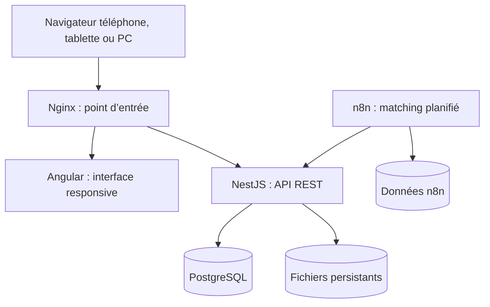
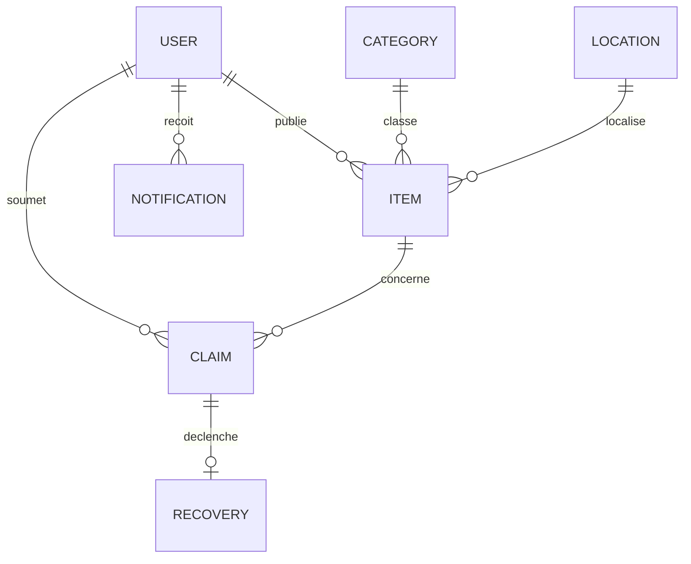
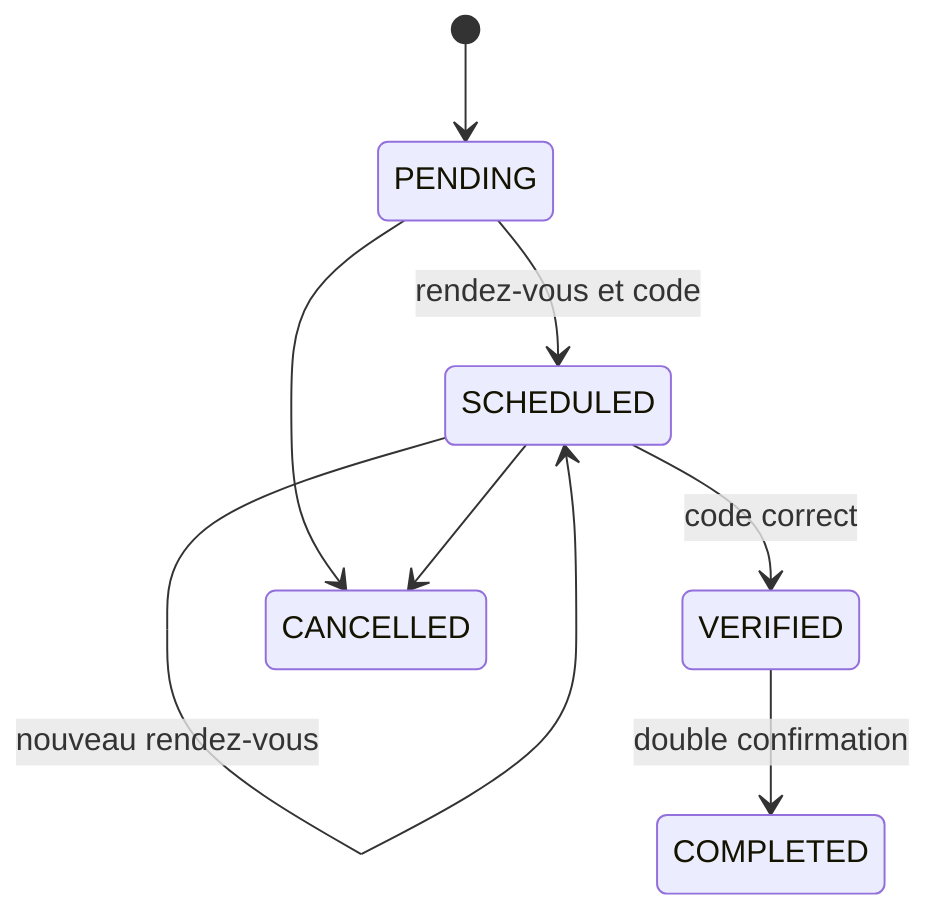

# Architecture — Campus Lost & Found

## Objectif

L’application met en relation, sans exposer les informations privées, une personne qui a perdu un objet et une personne qui l’a trouvé. Elle couvre la publication, la recherche, la preuve de propriété, la décision du déposant et la restitution physique sécurisée.

L’automatisation n8n reste découplée du métier : elle suggère des correspondances et crée des notifications, mais elle ne peut ni accepter une réclamation ni terminer une restitution.

## Vue des composants

Nginx publie le frontend et `/api/*`. Le backend et PostgreSQL ne sont pas exposés dans la composition complète. L’éditeur n8n est lié à `127.0.0.1` et s’ouvre à distance uniquement par tunnel SSH.

## Réseaux et frontières de confiance

| Zone                  | Services                      | Règle                                               |
| --------------------- | ----------------------------- | --------------------------------------------------- |
| Entrée                | `proxy`                       | Seul port public de l’application                   |
| Réseau `app`          | proxy, frontend, backend, n8n | Communications HTTP internes                        |
| Réseau `data` interne | backend, PostgreSQL           | Aucun accès direct depuis l’hôte                    |
| Volumes               | PostgreSQL, uploads, n8n      | Persistants, inclus dans la procédure de sauvegarde |

Le contrôle `/health` passe par Nginx, appelle réellement l’API puis exécute `SELECT 1` dans PostgreSQL. Un statut HTTP 200 signifie donc que le chemin complet est prêt.

## Modèle de données

Contraintes importantes :

- email utilisateur unique ;
- une seule réclamation par utilisateur et par annonce ;
- une seule restitution par réclamation ;
- suppression en cascade des données dépendantes d’un utilisateur, d’une annonce ou d’une réclamation ;
- catégories et localisations utilisées protégées par des relations restrictives.

## Parcours de restitution

Le code à six chiffres :

- est visible uniquement par le propriétaire physique de l’objet (ou un administrateur) ;
- est vérifiable uniquement par la personne qui détient physiquement l’objet (ou un administrateur) ;
- expire après 30 minutes ;
- est verrouillé après cinq réponses incorrectes ;
- est supprimé de la base après validation, tandis que l’heure de validation est conservée ;
- est remplacé et ses tentatives sont remises à zéro lors d’une replanification.

## Contrôles d’accès

| Action                              | Public |                 Utilisateur | Propriétaire/déposant | Admin |
| ----------------------------------- | -----: | --------------------------: | --------------------: | ----: |
| Rechercher et consulter une annonce |    Oui |                         Oui |                   Oui |   Oui |
| Publier et gérer ses annonces       |    Non |                         Oui |                   Oui |   Oui |
| Envoyer une réclamation             |    Non | Oui, hors sa propre annonce |                     — |   Oui |
| Lire une preuve privée              |    Non |          Réclamant concerné |                   Oui |   Oui |
| Accepter/refuser une réclamation    |    Non |                         Non |                   Oui |   Oui |
| Gérer utilisateurs et référentiels  |    Non |                         Non |                   Non |   Oui |
| Vérifier le code de remise          |    Non |         Selon rôle physique |   Selon rôle physique |   Oui |

## Décisions de déploiement

- Ubuntu Server 24.04 LTS 64 bits est la cible VM documentée.
- Docker Compose fournit un environnement reproductible identique sur Windows et Linux.
- `APP_BIND_ADDRESS=127.0.0.1` est la valeur locale sûre ; une VM de démonstration accessible sur le LAN utilise explicitement `0.0.0.0`.
- PostgreSQL et les fichiers envoyés restent dans des volumes Docker ; une sauvegarde logique et des archives de volumes sont fournies.
- Un déploiement Internet nécessite en plus un nom de domaine, TLS, une politique de pare-feu Docker et une sauvegarde distante chiffrée.
